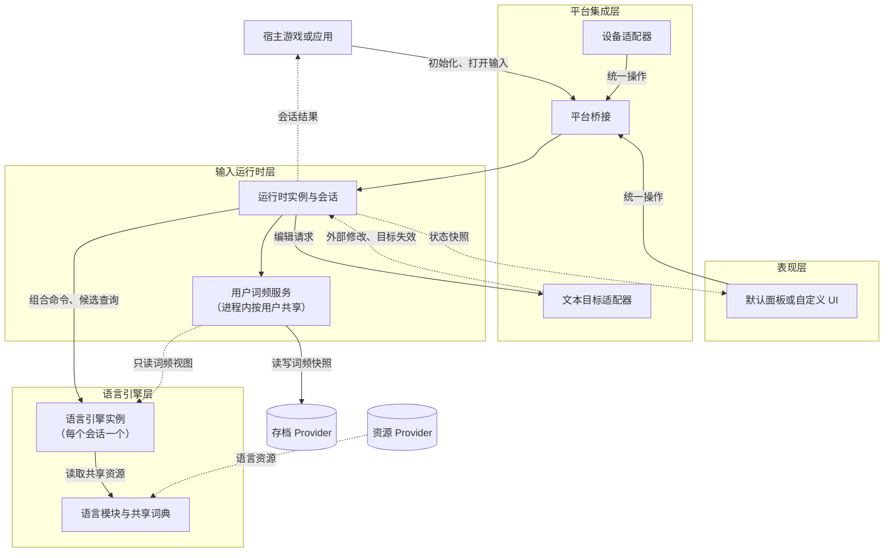

# SkyKeyYuyan 系统架构

> **读者**：框架开发者，以及需要自己实现设备、文本框、UI 或存档扩展的集成开发者。
> **先读**：[README](README.md) 中的核心约定和[术语](README.md#术语)。

本文回答五个问题：

- SKY 分成哪几层，每层负责什么，可以依赖谁；
- 运行时实例如何创建、替换和结束，用户词频如何在实例之间共享；
- 运行时、会话、引擎等对象由谁创建、谁释放，哪些可以共享；
- 语言如何注册和初始化，代码在哪个执行上下文中运行；
- 一次按键从设备到文本框经过哪些环节，以及可以在哪里扩展。

接口签名和字段定义不在本文展开，见[接口与数据契约](api-contracts.md)。

## 四层结构

SKY 把一次输入拆成四件事：理解语言、调度会话、对接平台、展示界面。这样拆分，语言引擎和输入运行时就不依赖 Unity，可以直接给独立 .NET 程序使用；更换 UI 框架或输入设备时，也只需替换外围的适配层。

下表从底层往上排列：

| 层 | 负责什么 | 接收 | 产出 |
| --- | --- | --- | --- |
| 语言引擎 | 拼写解析、组字与回退历史、词典查询、候选排序和转换 | 组合命令 | 组字快照、候选、待提交片段 |
| 输入运行时 | 语言注册与资源准备、会话管理、操作排序、文本编辑协调、故障恢复、用户词频 | 统一输入操作 | 会话快照、操作结果、完成结果 |
| 平台集成 | 设备事件、宿主执行上下文、焦点、文本框和生命周期 | 平台事件 | 统一输入操作、文本目标 |
| 表现 | 行内组字、浮动候选、虚拟键盘、草稿框和配置入口 | 会话快照 | 用户交互产生的统一操作 |

各层之间的依赖规则：

- **底层不认识平台。** 语言引擎层和输入运行时层只使用 .NET 数据类型和接口。Unity 对象、文本控件、设备句柄和字体资源都由平台集成层和表现层持有。
- **引擎不直接访问存档。** 引擎只依赖配置传入的语言资源和只读的词频视图。
- **表现层只走公开通道。** 表现层通过会话快照读取状态，通过统一操作改变状态。默认面板和自定义 UI 使用的是同一套接口。

**关于「核心」**：文档中的「核心」指核心包，包含输入运行时、公共接口与数据契约、基础英语引擎和词频契约（见[分发与构建](distribution-and-build.md)）。它横跨输入运行时层和语言引擎层。中文、韩语和英语补全引擎由各自的语言包提供。

### 组件关系图

图例：实线表示调用或发送请求，虚线表示数据或通知的回流。

独立 .NET 宿主没有 Unity 的平台集成层时，由宿主自己承担这一层：直接调用运行时和会话，实现文本目标，并把自己的输入转换为统一操作。

## Unity 适配的组成

Unity 相关代码全部位于平台集成层和表现层，按发布包划分如下（详见 [Unity 接入与默认表现](unity-integration.md)）：

| 模块 | 所在层 | 发布包 | 职责 |
| --- | --- | --- | --- |
| Unity 转换核心 | 平台集成 | Unity 适配 | 运行时初始化、主线程调度、玩家上下文、文本目标和生命周期桥接 |
| Legacy Input 适配、Input System 适配 | 平台集成（设备适配器） | Unity 适配 | 把设备事件转换为统一操作，并附上玩家和设备归属 |
| UGUI 适配、TMP 适配 | 平台集成（文本目标适配器） | Unity 适配 | 输入框的文本、选区、验证、导航和编辑态 |
| FairyGUI 适配 | 平台集成（文本目标适配器） | FairyGUI 适配，单独安装 | GTextInput 目标，以及 FairyGUI 焦点和生命周期桥接；FairyGUI SDK 由宿主提供 |
| UGUI 默认表现 | 表现 | 单独安装，依赖 Unity 适配 | UGUI 输入面板、虚拟键盘和草稿正文 |
| FairyGUI 默认表现 | 表现 | 单独安装，依赖 FairyGUI 适配 | FairyGUI 输入面板、虚拟键盘和草稿正文 |

两套默认表现都使用通用的键盘布局和会话接口来渲染语言内容，不包含某种语言的专用代码。

## 运行时实例

SKY 运行时，也就是统一语言服务，负责管理语言并提供输入。一个进程中可以同时存在多个运行时实例，其中一个是**全局默认实例**。

- **打开输入**：默认使用全局默认实例，也可以指定另一个实例。这样可以同时维护多套语言配置。
- **实例内能改什么**：语言只能添加，不能注销。词库类数据（例如自定义词组）可以在运行期间增减。语言数据和实现配置不能在实例内替换。
- **更换语言数据或实现配置**：初始化一个新实例。新实例初始化成功后，默认取代当前的全局默认实例。只给特定会话使用的实例，可以在 RuntimeOptions 中关闭这一行为，避免顶掉全局默认实例。

### 实例的替换与结束

旧实例被替换后不会立即释放：已打开的会话继续使用它，只有新会话改用新的全局默认实例。实例有两种结束方式：

| 结束方式 | 处理 |
| --- | --- |
| 被替换后，最后一个会话结束 | 自动保存待写的词频，释放自身资源，之后交给 GC 回收 |
| 宿主显式调用 `Dispose` | 先结束仍然打开的会话，再保存待写的词频，最后按依赖顺序释放资源 |

显式 `Dispose` 时，仍然打开的会话以结束原因「运行时释放」结束，每个会话各发布一次 `Completed`。草稿模式下，草稿及其暂存的选择记录按取消处理并丢弃；原输入框模式下，已经写入目标的正文保留。保存失败通过诊断报告。

## 用户词频

### 在实例之间共享

用户词频服务不属于某个运行时实例，而是在进程内按用户标识共享。新旧实例并存，或者自定义实例和全局默认实例服务同一个用户时，所有选择都累计到同一份数据中，存档修订号统一递增，不会互相覆盖。旧实例被回收也不会丢失词频。

共享词频按用户和语言同步内存变更，读取时复制出不可变视图。会话的串行执行上下文只管理该会话；不同运行时的会话通过共享词频服务完成跨上下文合并。

存档 Provider 在进程内只配置一次：宿主可以在创建第一个实例之前设置，也可以由第一个实例的 RuntimeOptions 带入，之后的实例都沿用它。

### 加载时机

- **默认用户**：RuntimeOptions 指定一个默认用户，初始化时预加载，适合单用户的单机游戏。SessionOptions 省略用户标识时，使用这个默认用户。
- **其他预加载用户**：RuntimeOptions 还可以列出其他需要预加载的用户。预加载失败不算初始化失败，按下面的加载失败规则处理。
- **会话打开时才出现的用户**：打开会话时不等待加载。会话立即可用，先只按基础权重排序；后台加载完成后刷新候选。加载期间产生的选择记录保留在内存中，加载完成后合并。

### 加载失败

加载某个用户的词频失败时，先自动重试一次。重试仍然失败时当作空存档处理，之后照常保存，这会覆盖该用户原有的存档数据。这样做是为了避免一次读取失败后，这个用户再也无法存档。失败和覆盖都通过诊断报告。

## 资源所有权

总体原则是：**只读数据共享，可变状态独占。** 词典、索引和键盘布局这类只读数据归语言模块，可以被多个会话共用；组字、回退历史和草稿这类可变状态归会话或它的引擎实例，不跨会话共享。

| 对象 | 所有者 | 生命周期 | 共享范围 |
| --- | --- | --- | --- |
| 运行时实例 | 宿主 | 宿主创建和初始化；结束方式见[实例的替换与结束](#实例的替换与结束) | 已准备好的模块目录，供该实例的会话使用 |
| 语言模块资源 | 语言模块 | 由所属运行时实例决定准备和释放的时机 | 只读词典、索引和键盘布局，由同一实现的所有引擎实例共享 |
| 语言引擎实例 | 会话 | 随会话创建和释放；故障恢复时可能重建，并推进引擎代次 | 不共享，只读取模块的只读资源 |
| 组字和回退历史 | 引擎实例 | 与引擎实例相同 | 不跨实例共享；不可变的历史节点可以在同一实例的不同检查点之间复用 |
| 检查点 | 会话 | 由引擎创建；会话在可能改变组合状态的操作之前取得并保留 | 只在运行时内部用于恢复 |
| 会话 | 宿主 | 宿主打开，完成或取消后释放 | 不共享 |
| 草稿文本目标 | 会话 | 草稿模式打开会话时建立，会话结束时丢弃 | 不共享 |
| 宿主文本目标 | 宿主或平台适配 | 由宿主控件决定 | 同一时间只有一个会话持有编辑权：会话打开时取得，结束时释放，暂停期间不释放 |
| 用户词频服务 | 进程 | 按用户组织，不随某个运行时实例结束 | 同一用户在所有实例中的会话共同读取和累计 |
| 资源 Provider | 宿主 | 宿主创建并负责释放，通过 RuntimeOptions 传入；运行时只借用 | 供该实例准备语言资源 |
| 存档 Provider | 宿主 | 宿主创建并负责释放，进程内配置一次；运行时只借用 | 供共享的用户词频服务读写存档 |
| 默认面板 | 对应玩家的表现控制器 | 随该玩家的表现控制器 | 静态 UI 资源 |

运行时从不调用 Provider 的 `Dispose`，因此多个实例可以安全地共用同一个 Provider。Unity 默认使用的 PlayerPrefs Provider 和资源加载器，由 Unity 转换核心以宿主的身份创建和释放。

会话结束时，会释放它的引擎实例、查询任务引用、目标编辑权和事件订阅。共享资源只要仍有使用者，就保持有效。

在途候选查询也持有引擎和模块资源的使用权。会话结束或引擎重建时发出取消请求，后台任务退出后才释放其持有的资源。运行时在最后一个会话及最后一个后台任务结束后回收模块。

## 注册与初始化

### 语言标识和引擎标识

- **语言标识**表示输入的是哪种语言，例如英语。
- **引擎标识**表示用哪一种具体实现，例如基础英语（直接输入）或英语补全。

基础英语和英语补全的语言标识相同、引擎标识不同。每个语言入口使用哪个实现，由宿主在初始化运行时实例时显式配置。

### 从注册到可用

一个语言实现要经过三个阶段才能被会话使用：

1. **注册**：`RegisterLanguage` 把模块描述和工厂加入实例的目录。工厂由宿主显式传入，因此实现关系可以静态引用，在 IL2CPP 裁剪和 AOT 环境下依然可用。
2. **资源准备**：首次初始化（`Initialize` / `InitializeAsync`）会准备所有已配置的模块。首次初始化之后才注册的模块，用 `InitializeLanguage(engineId)` 单独准备。
3. **就绪**：资源准备成功后，该实现就可以为会话创建引擎实例。

同步路径和异步路径返回的结果语义相同。

### 初始化失败时

首次初始化按一次完整的尝试来处理：收集配置、准备语言资源、建立服务。任何一步失败，都会释放本次已经取得的资源，但保留注册配置，调用者修正环境或配置后可以重试。异步初始化被取消时，走同一条清理路径。初始化失败的实例不会取代全局默认实例。

用户词频的预加载也在首次初始化时进行，但它的失败不影响初始化结果，见[加载失败](#加载失败)。

运行期间新增模块的失败只影响它自己：失败通过该模块的初始化结果报告，已经就绪的模块和已经打开的会话照常工作。

### 配置何时生效

会话打开时，会固定自己所用的运行时实例、语言列表和每种语言使用的实现。实例中新增语言后，只有新打开的会话可以选择它，正在进行的输入不受影响。会话内的英语补全开关属于会话自身的状态。

要更换语言数据或实现配置，请初始化新的运行时实例，见[运行时实例](#运行时实例)。

## 执行上下文

会话状态只在一个执行上下文中修改，这样既不需要加锁，也能避免回调重入；Unity 的很多 API 也只能在主线程调用。

具体规则：

- 会话操作、快照替换和事件发布，都在宿主指定的执行上下文中串行执行。Unity 适配使用主线程，独立 .NET 宿主可以提供自己的调度器。
- 候选查询和资源读取可以在后台执行。后台工作只接收不可变的请求，只返回数据；是否采用结果，由会话在自己的执行上下文中决定。
- 一个会话在等待转换时，其他会话照常接收操作。
- 事件回调中产生的新操作，会排队进入会话的处理流程，不会在状态修改到一半时重入。

### 引擎实例的并发约束

`QueryCandidatesAsync` 只读取 `CandidateQuery` 携带的不可变数据和语言模块的只读资源，不访问引擎实例的可变状态。因此，后台查询可以和同一实例上的 `Process` 并行执行，引擎实例本身不需要加锁。

这是对所有引擎实现的约束：查询需要的组字信息，必须全部放进 `CandidateQuery`。

### 异步结果的接纳条件

后台结果返回时，会话的状态可能已经变化。只有同时满足下列所有条件，会话才会采用这个结果：

| 检查项 | 不满足时的典型原因 |
| --- | --- |
| 会话仍然有效 | 会话已经结束 |
| 引擎实例代次一致 | 故障恢复重建了引擎实例 |
| 组字版本一致 | 玩家又输入或回退了 |
| 词典版本一致 | 宿主更新了自定义词组 |
| 设置版本一致 | 会话设置发生了变化 |

这些版本对应 `CandidateQuery` 中的同名字段。

接纳结果还要求查询标识与当前请求一致。词频加载完成或变化时，即使组字未变，也创建新的查询标识，以保留最新词频视图的排序结果。

## 一次输入的完整流程

下面以一个具体场景，说明一次输入依次经过哪些层。

**场景**：玩家 1 用手柄在 TMP 输入框里输入「你好」。手柄默认使用自绘草稿模式。

| 步骤 | 所在层 | 发生了什么 |
| --- | --- | --- |
| 1 | 平台集成 | 文本框进入编辑态，SKY 使用全局默认实例为玩家 1 打开会话：读取目标正文和选区，取得编辑权，固定语言列表和实现，并复制正文建立草稿文本目标。默认面板随之打开。 |
| 2 | 平台集成 → 表现 | 玩家在虚拟键盘上移动，然后按 A。Input System 适配读到按键，并附上玩家和设备归属。虚拟键盘内的焦点移动属于面板内部交互；按下 A 后，面板发出一次「字符输入 n」统一操作。 |
| 3 | 平台集成 | 平台桥接根据设备启用策略、焦点和会话绑定，把操作交给玩家 1 的会话。 |
| 4 | 输入运行时 | 会话为操作分配标识，按需保存检查点，再把语言命令交给中文引擎。 |
| 5 | 语言引擎 | 引擎同步更新组字，并提出候选查询的需求。 |
| 6 | 输入运行时 → 表现 | 会话发布新的不可变快照，面板显示组字「n」和「候选处理中」。 |
| 7 | 输入运行时 | 候选查询在后台执行。玩家继续输入到「nihao」时，针对「n」的旧查询结果因组字版本不同而被丢弃；针对「nihao」的结果通过接纳检查，进入快照。 |
| 8 | 语言引擎 | 玩家按 L3 确认「你好」。引擎消耗全部拼写，产出待提交片段和一条选择记录（ChoiceRecord）。 |
| 9 | 输入运行时 | 会话把「你好」写入草稿文本目标，选择记录放入会话暂存区。 |
| 10 | 输入运行时 → 平台集成 | 玩家按 X 完成。会话把草稿作为全文替换请求交给 TMP 文本目标适配器，由适配器执行验证和长度处理，并返回实际接受的结果。暂存的选择记录合并进共享的用户词频。 |
| 11 | 输入运行时 → 宿主 | 会话发布一次 `Completed`，宿主拿结果处理业务。会话释放引擎实例、编辑权和事件订阅；Unity 默认存档在会话结束时批量保存词频。 |

**原输入框模式的不同之处**：第 1 步不建立草稿；第 9 步直接通过 TMP 适配器对原目标做选区替换（包括验证和长度处理），选择记录直接进入用户词频；第 10 步完成时也就不需要回填。两种模式的完整规则见[会话与文本编辑](session-and-editing.md)。

**各项结果分别记录。** 文本写入、选择记录和事件通知的执行状态是分开保存的。出现故障时，恢复流程根据每一项的实际结果继续处理。例如正文已经写入成功，但之后宿主回调抛出异常，已写入的正文仍然有效。详见[恢复与词频存储](recovery-and-persistence.md)。

## 扩展点

| 想替换或新增 | 需要实现 | 参考 |
| --- | --- | --- |
| 语言 | 模块描述、资源准备、引擎工厂、语言资源和键盘布局；候选查询遵守[并发约束](#引擎实例的并发约束) | [语言引擎](language-engines.md) |
| 设备 | 把设备事件转换为统一输入操作，并附上玩家和设备归属 | [Unity 接入与默认表现](unity-integration.md) |
| 文本框 | `ITextTarget`：文本快照、编辑结果、光标导航，以及通过 `Changed` 事件上报变化 | [会话与文本编辑](session-and-editing.md) |
| UI | 读取会话快照，发送统一操作 | [Unity 接入与默认表现](unity-integration.md) |
| 存档 | 结构化词频快照的同步和异步读写 | [恢复与词频存储](recovery-and-persistence.md) |
| 运行环境 | 执行上下文、资源加载和宿主生命周期 | 本文「执行上下文」一节 |

**设备不负责路由。** 设备扩展只负责转换事件，把操作交给哪个会话，统一由平台桥接根据启用策略、焦点和会话绑定决定，这样这些规则只在一处实现。没有平台桥接的独立 .NET 宿主，自己调用会话的 `Process`。

**文本框主动上报变化。** `ITextTarget` 通过 `Changed` 事件上报两类变化：宿主在外部修改了正文，或者目标失效（例如控件被销毁）。适配器本来就要靠操作归属区分 SKY 自己的写入和宿主的修改，有了这个事件就能及时通知会话。会话在自己的执行上下文中处理这个事件，并按[外部变化](session-and-editing.md)规则结束会话。

所有扩展的接口定义见[接口与数据契约](api-contracts.md)。
